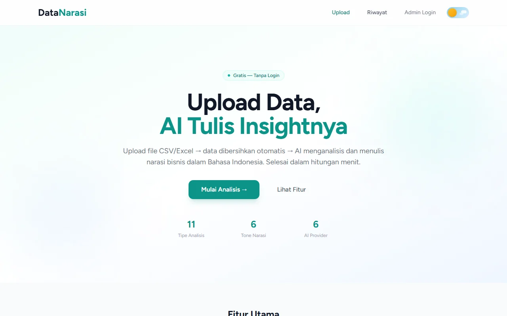

# DataNarasi

**Upload CSV/Excel → Auto Clean → Statistik & Grafik Interaktif → Narasi Insight Bisnis Otomatis (Bahasa Indonesia)**

[](https://data-narasi.pinnhost.my.id/)




### Fallback Chain 6 AI Provider

```text
Google Gemini ──► Kimi (Moonshot) ──► GLM (Zhipu) ──► NVIDIA NIM ──► MiniMax ──► Claude
```

Jika satu provider terkena rate-limit, sistem otomatis berpindah ke provider berikutnya sesuai urutan di `.env`.

### Fitur & Stack

| Komponen | Teknologi | Kegunaan |
| :--- | :--- | :--- |
| **Web & Auth** | Laravel 12, Vue 3, Inertia.js, MySQL | Upload dataset (≤10MB), riwayat analisis, ekspor laporan |
| **Data Engine** | Python 3.11, FastAPI, Pandas, Matplotlib | Deduplikasi, pembersihan missing value, tren & statistik |
| **Visual & AI** | Chart.js + Multi-AI Adapter | Grafik interaktif dan ringkasan eksekutif Bahasa Indonesia |

### Quick Start

```bash
# Web App (Laravel + Vue)
composer install && npm install && php artisan migrate && npm run dev & php artisan serve

# Python Data Engine
cd python-service && pip install -r requirements.txt && uvicorn main:app --port 8001 --reload
```
